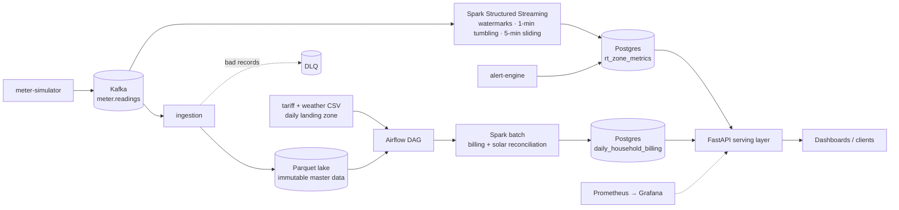

<div align="center">

# ⚡ Smart Grid Lambda Platform

**Real-time grid monitoring and daily household billing on a Lambda architecture —
Kafka → Spark Structured Streaming + Spark batch → Postgres → FastAPI, orchestrated by Airflow.**


</div>

## The question it answers

> *What is the current grid load and renewable contribution by zone — and what will each
> household's bill be once the daily tariff is applied to its consumption?*

The first half needs **seconds-fresh, approximate** answers; the second needs **exact,
recomputable** ones. That tension is exactly what the Lambda architecture is for.
(Lambda vs Kappa trade-off: [ADR-0001](docs/decisions/ADR-0001-lambda-vs-kappa.md).)

## Architecture



| Layer | Implementation | Guarantee |
|---|---|---|
| **Speed** | Spark Structured Streaming with watermarking for late data | Low-latency, approximate |
| **Batch** | Spark batch over closed lake partitions + tariff/weather feeds | Authoritative, idempotent upserts |
| **Serving** | FastAPI over Postgres, merging both views | One API for real-time and billing |
| **Orchestration** | Airflow `daily_energy_reconciliation` DAG — sensors, job, DQ checks | Runs only when inputs are complete |
| **Observability** | Prometheus, Grafana, rule-based alert engine | Data-gap, SLA and reject-rate alerts |

## Engineering highlights

- **Hexagonal shared kernel** (`libs/common`) — domain models and port interfaces shared by
  7 services; adapters are swappable.
- **Strategy pattern for tariffs** — `FlatBilling`, `TieredBilling`, `SubsidisedBilling`.
- **Idempotent, recomputable batch layer** — rerunning a day produces the same bill.
- **Data contracts** between every producer and consumer ([`DATA_CONTRACTS.md`](docs/DATA_CONTRACTS.md)).
- **Simulated clock** so a full "day" of grid data can be demoed in minutes.
- **Layered Docker Compose** — base infrastructure + overlay for processing (`make up` / `make up-full`).
- **127 automated tests** across services.

## Screenshots

| Airflow DAG | Billing report |
|---|---|
|  |  |

## Quick start

```bash
cp .env.example .env
make up-full          # Kafka, Postgres, Spark jobs, Airflow, API, Prometheus, Grafana
```

Setup details: [`docs/DEV_SETUP.md`](docs/DEV_SETUP.md) · Operating the demo: [`docs/RUNBOOK.md`](docs/RUNBOOK.md) ·
Full architecture: [`docs/ARCHITECTURE.md`](docs/ARCHITECTURE.md) · Service-by-service walkthrough: [`SETUP.md`](SETUP.md)

---

Built for EC8203 Applied Big Data Engineering, University of Ruhuna (2026).
**G.W. Niranga Niluminda** · [LinkedIn](https://linkedin.com/in/niranganiluminda)
