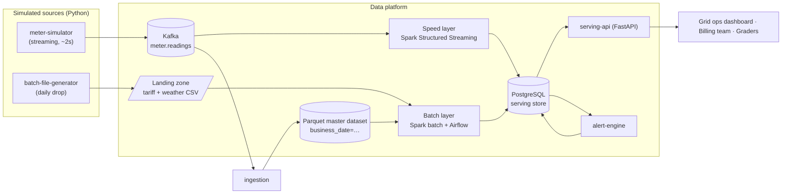
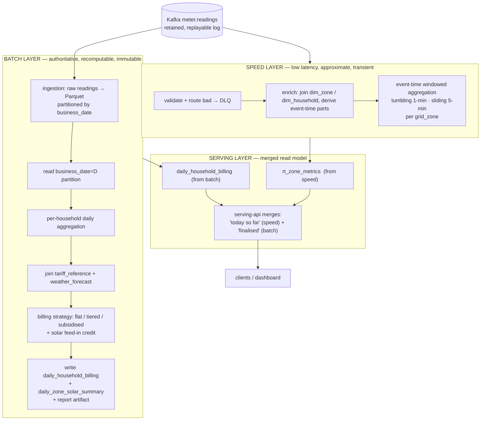
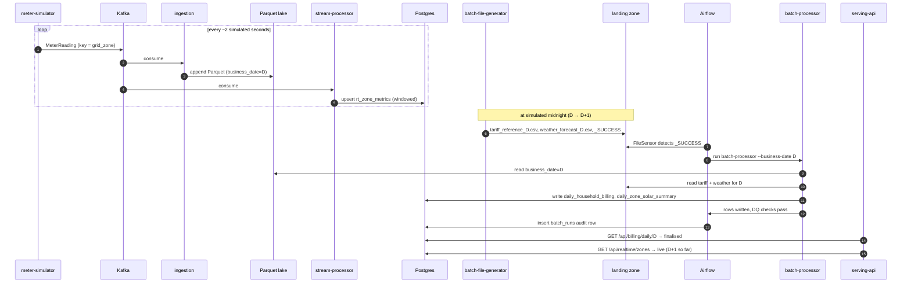
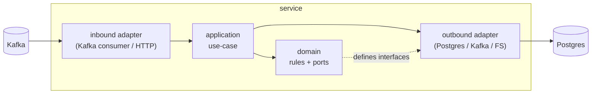
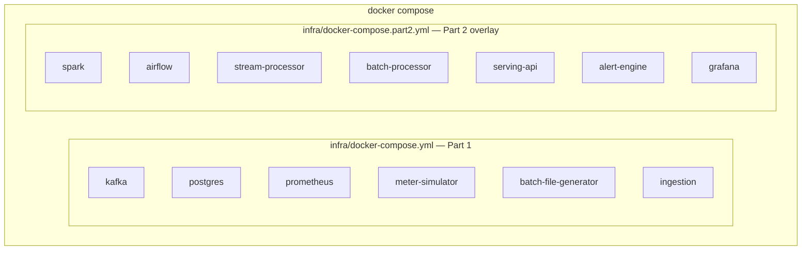

# Architecture

Smart Grid Energy Monitoring & Billing — **Lambda architecture**.

- The decision itself (Lambda vs Kappa, rejected alternative) → [`decisions/ADR-0001-lambda-vs-kappa.md`](decisions/ADR-0001-lambda-vs-kappa.md)
- Per-component tech justification → [`decisions/ADR-0002-technology-stack.md`](decisions/ADR-0002-technology-stack.md)
- Every schema / topic / file format → [`DATA_CONTRACTS.md`](DATA_CONTRACTS.md)

---

## 1. Context



## 2. Lambda layers



**Speed layer** answers *"grid load and renewable mix by zone right now"*. It is allowed to be
approximate: readings that arrive after their window's watermark are dropped from the live view —
the batch layer will account for them.

**Batch layer** answers *"what is each household's bill for business day D"*. It runs once the day
is closed **and** the day's tariff/weather feed has landed. It recomputes from the immutable Parquet
master dataset, so re-running it for a past day (tariff correction, late data) reproduces an exact,
auditable result.

**Serving layer** is a plain read model in Postgres. `serving-api` never computes — it reads
`rt_zone_metrics` for the live view and `daily_household_billing` for finalised days, and stitches
them so a client sees one coherent picture.

## 3. Request / data flow — a full simulated day



## 4. Service internal structure (hexagonal)

Every service follows the same shape so a reader who understands one understands all:

```
services/<name>/
  src/<pkg>/
    domain/        pure business rules + models + PORT interfaces   (no framework imports)
    application/   use-cases orchestrating the domain via ports
    adapters/      inbound + outbound implementations of the ports  (Kafka, Postgres, FS, HTTP)
    config.py      Settings (pydantic-settings), validated at startup
    composition.py composition root — builds adapters, injects into the use-case
    __main__.py    process entrypoint
  tests/
    unit/          domain + application, every port faked
    integration/   adapters against real infra   (marker: integration)
  Dockerfile
  pyproject.toml
  README.md
```



The domain defines the interfaces; the adapters implement them; the composition root is the only
code that imports both. This is what lets us unit-test all business logic with zero infrastructure.

## 5. Deployment



- `make up` → Part 1 only (what exists today).
- `make up-full` → both files, the whole platform.
- One Postgres instance, two databases: `energy_serving` and `airflow`.
- Kafka in KRaft mode (no ZooKeeper container).

## 6. Simulated time

| Knob | Default | Meaning |
|---|---|---|
| `SIM_DAY_SECONDS` | 600 | wall-clock seconds per simulated business day |
| `SIM_EPOCH_WALLCLOCK` | process start | wall-clock instant mapped to simulated `SIM_START_DATE` 00:00 |
| `SIM_START_DATE` | 2026-01-01 | first simulated calendar date |

`energy_common.simclock.SimClock` converts between wall-clock and simulated time.
`business_date_for(simulated_ts)` returns the `date` a reading belongs to. The batch generator
fires its drop when the simulated clock crosses midnight; Airflow processes the day that just closed.
All simulated-time behaviour is unit-tested around the midnight boundary.
