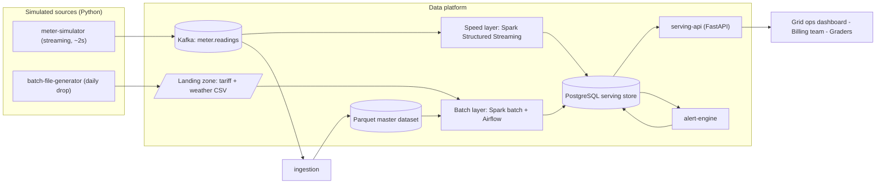
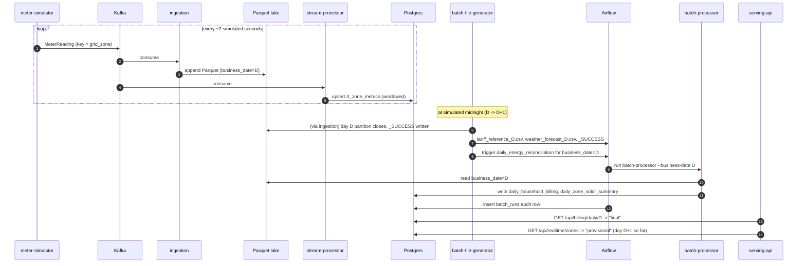
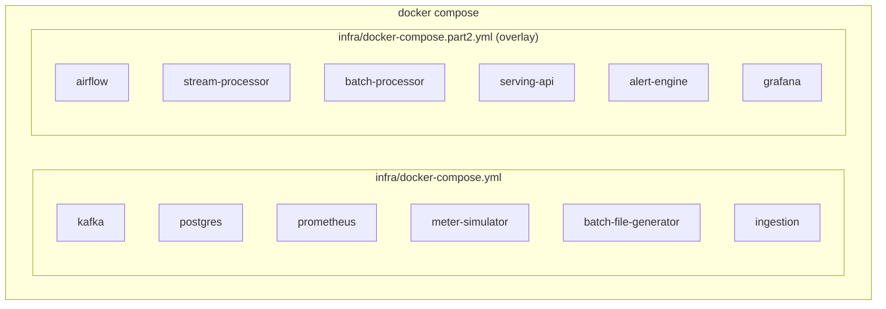
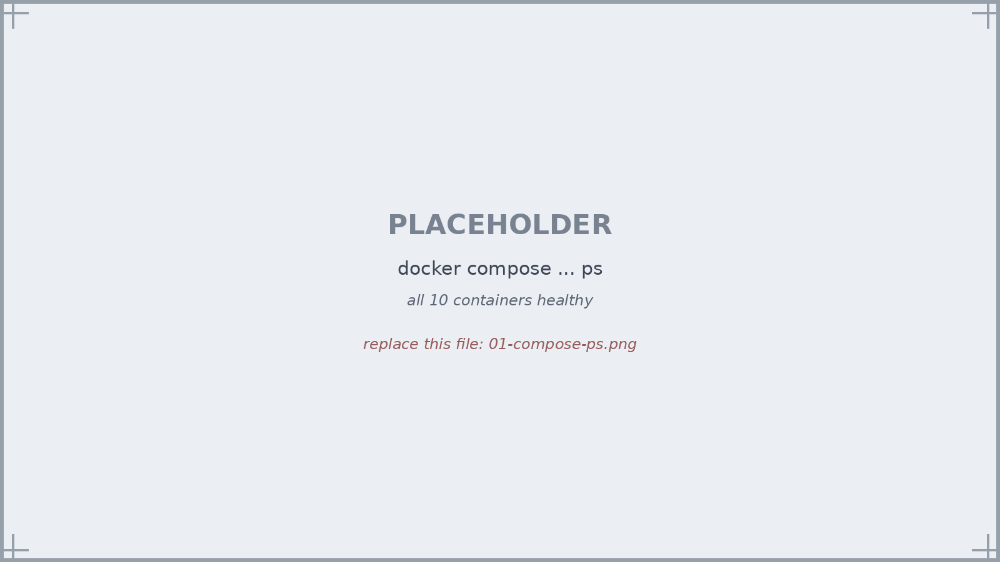
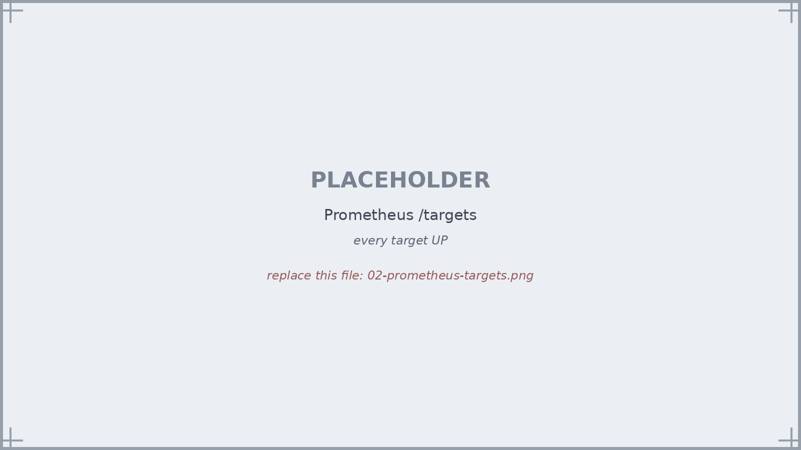
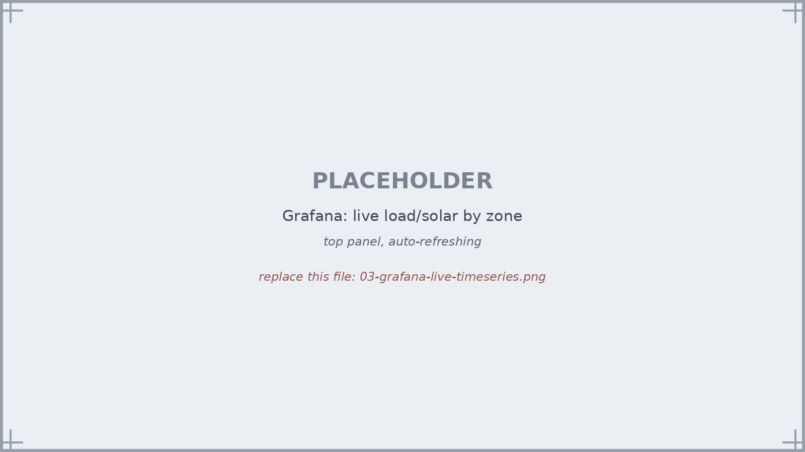
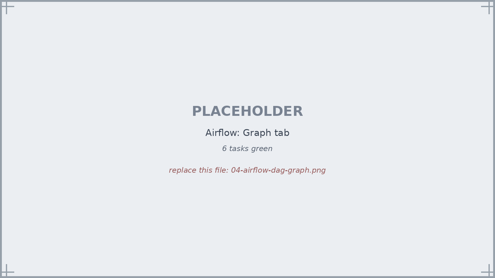
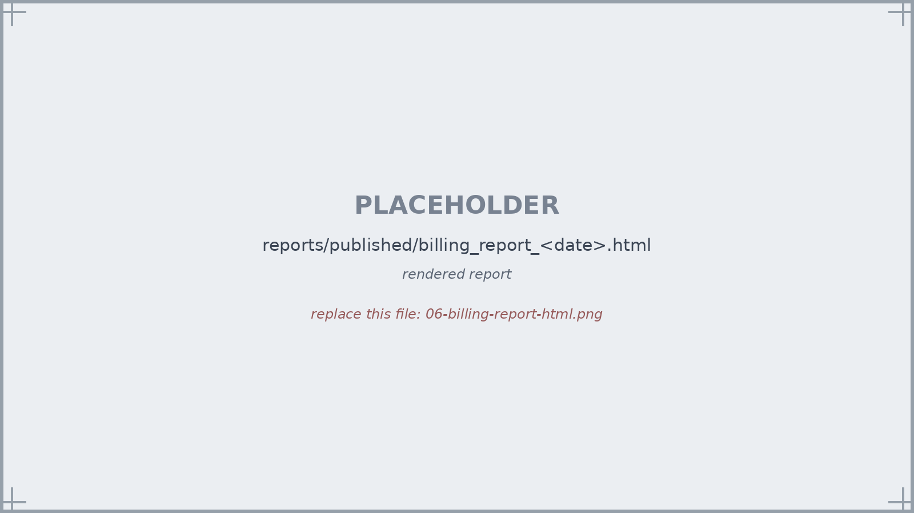
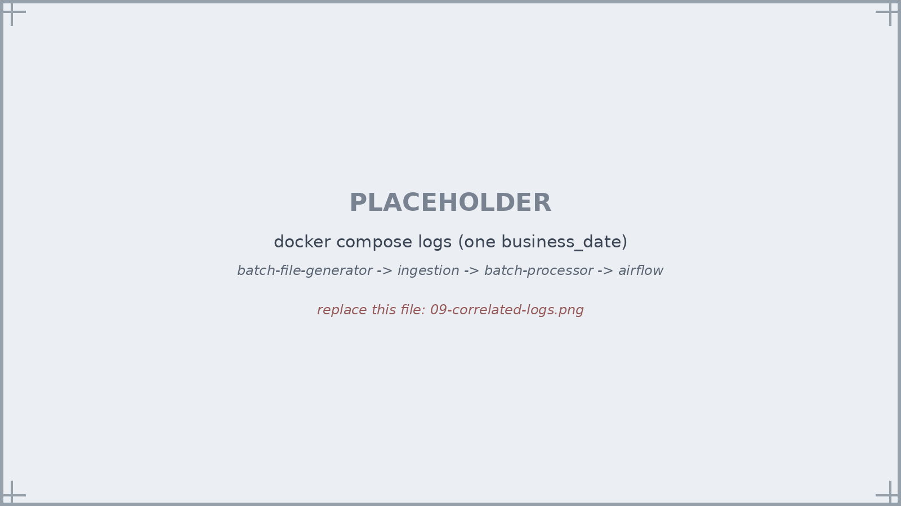

# Applied Big Data Engineering — Mini Project Report

## Smart Grid Energy Monitoring & Billing: A Lambda Architecture Data Platform

**Module:** EC8203 Applied Big Data Engineering
**Repository:** <https://github.com/NirangaNiluminda/smart-grid-lambda-platform>
**Authors:** Niluminda G.W.N, EG/2021/4691 (Dev A — Foundation & Ingestion) · Niroshan I.J, EG/2021/4695 (Dev B — Processing, Serving & Observability) · Kavinda S.O, EG/2021/4608 (Dev C — Processing, Serving & Observability)

---

## 1. Introduction

### 1.1 Use case

This project implements **Use Case 3 — Smart Grid Energy Monitoring & Billing**
from the assignment brief. A utility company wants two things at once:

1. **Live visibility** into grid load and the renewable (solar) contribution to
   that load, broken down by grid zone, updated continuously as smart-meter
   readings arrive.
2. A **daily, authoritative reconciliation**: once a business day has closed and
   the day's tariff and weather reference data has been received from the
   billing system, compute exactly what each household owes and how much of
   the zone's demand was met by solar that day.

**Business question.** *What is the current grid load and renewable
contribution by zone, and what will each household's bill look like once daily
tariff data is applied to their consumption?*

These are genuinely different problems even though they share a data source.
The first needs to be fast and can tolerate being slightly wrong (a reading
that arrives a few seconds late does not materially change "current load").
The second needs to be exact, auditable, and reproducible — it is a financial
calculation that must reconcile to the cent and must be re-computable if a
tariff is corrected after the fact. That distinction is the entire justification
for the architecture chosen in §2.

### 1.2 Data sources (simulated)

Two Python services simulate the real-world sources described in the brief:

| Source | Frequency | Fields |
|---|---|---|
| **Smart meters** (`meter-simulator`) | one reading per household roughly every 2 simulated seconds | `meter_id, household_id, grid_zone, power_consumption_kwh, solar_generation_kwh, reading_interval_seconds, event_timestamp` |
| **Tariff & weather feed** (`batch-file-generator`) | once per simulated day | `tariff_reference_<date>.csv` (household_id, tariff_rate, billing_tier, subsidy_flag, effective_date) and `weather_forecast_<date>.csv` (grid_zone, forecast_date, cloud_cover_pct, temp_c, solar_irradiance_index) |

The streaming source deliberately injects realistic anomalies at a configurable
rate (`SIM_ANOMALY_RATE`, default 2%): dropped readings, negative values,
implausible spikes, a "stuck" meter repeating its last value, and zero
readings. The platform is expected to detect and quarantine these, not silently
average them into the results (see §5 and §6).

### 1.3 Assumptions and simplifications

- **Simulated time.** One simulated business day is compressed into
  `SIM_DAY_SECONDS` wall-clock seconds (600 by default — 10 minutes; the demo
  recording uses a shorter value so a full day-close is visible inside a short
  video). All services derive "what day is it" from a single shared
  `SimClock`, so the streaming source, the daily feed, and the batch
  orchestration all agree on the current simulated date.
- **Household population.** 200 synthetic households spread evenly across 6
  grid zones (`data/seed/households.csv`), each with a diurnal load profile and
  (for ~35% of households) a solar installation, deterministically generated
  from a seed so results are reproducible.
- **Currency and tariff model.** Tariffs are illustrative (LKR/kWh), with three
  billing tiers (flat, tiered-block, subsidised) chosen per household at
  random each simulated day, to exercise the Strategy-pattern billing logic
  described in §6.
- **Single-node deployment.** Kafka runs as a single KRaft broker, Spark runs
  in local mode inside each processing container, and Airflow runs in
  `standalone` mode (webserver + scheduler + triggerer in one process). This is
  the right scope for a mini-project demonstrating the architecture; §10
  discusses what would change at production scale.
- **No authentication** on the serving API or dashboards, consistent with a
  local/demo deployment.

---

## 2. Architecture Decision: Lambda vs Kappa

### 2.1 The forces

| | Real-time zone view | Daily household bill |
|---|---|---|
| Latency requirement | seconds | "ready the morning after" |
| Consistency requirement | eventual / approximate acceptable | strong — must reconcile exactly |
| Input | unbounded, partial stream | one bounded, closed day + a once-daily reference feed |
| Reprocessing | not meaningful | **required** (a corrected tariff or late data must be re-billable) |
| Natural trigger | continuous | "business day D has closed" **and** "the feed for D has landed" |
| Computation | rough per-zone sums over a short window | a per-household join of a full day's consumption × tariff × subsidy, minus a solar export credit |

These are not the same computation at two different freshness levels — they
are two different computations with two different correctness models and two
different consumers. That is precisely the situation Lambda architecture was
designed for.

### 2.2 Decision: Lambda

We adopted a **Lambda architecture**:

- A **speed layer** (Apache Spark Structured Streaming) consumes the raw
  meter-reading stream and maintains an approximate, continuously-updated
  view of load and renewable share per zone, using event-time windowing with
  watermarking to bound how long it waits for late data.
- A **batch layer** (Apache Spark batch job, orchestrated by Apache Airflow)
  runs once a simulated day's readings and its tariff/weather feed have both
  landed. It re-derives the authoritative per-household bill and per-zone
  solar summary from the **immutable master dataset** — every raw reading ever
  ingested, partitioned by business date in Parquet — so that a corrected
  tariff or a late-arriving batch of readings can always be reconciled by
  simply re-running the job for that date.
- A **serving layer** (PostgreSQL + a read-only FastAPI service) merges the
  two: a day that has not yet been through the batch layer is served as
  *provisional* (speed-layer numbers); a day the batch layer has finalised is
  served as *final* (batch-layer numbers).

### 2.3 Rejected alternative: Kappa

A Kappa architecture would treat the daily tariff feed as a compacted Kafka
topic and maintain the household bill as continuously-updated streaming state,
using the retained log for reprocessing instead of a separate batch job. We
considered this and rejected it for this use case, for three reasons:

1. **Billing is inherently periodic and bounded**, not continuous. A bill is
   "the invoice for day D," not a number that is always slightly provisional.
   Expressing "the day has closed, emit the final invoice" as
   watermark/allowed-lateness control flow inside a single streaming job is
   harder to reason about, and harder to audit, than a scheduled DAG with an
   explicit `business_date` parameter, a recorded run, and retries.
2. **Reprocessing cost.** Correcting one historical tariff error under Kappa
   means replaying the *entire* meter-reading history through a stateful
   streaming job. Under Lambda, the same correction touches exactly one
   Parquet partition — the closed day in question — and nothing else.
3. **The assignment's learning objectives and preferred stack** explicitly ask
   for both stream *and* batch processing techniques, and name Airflow for
   "managing batch jobs or reporting pipelines." Kappa would collapse the
   exercise into a single paradigm and leave the batch/orchestration
   objectives undemonstrated.

Kappa's usual advantage — one codebase, no dual logic to keep in sync — is
weaker here than it looks, because the two layers are not doing the same
computation twice: the speed layer computes a rough, live aggregate; the batch
layer computes an exact, audited one from different inputs (it also needs the
tariff feed, which does not exist until the day closes). To prevent the
remaining shared logic (reading validation, the energy-balance split between
self-consumption and grid import) from drifting between the two layers, both
the speed and batch implementations import the *same* pure functions from a
shared library (`energy_common.domain.transforms`) rather than re-implementing
them — see §6.

**When would we choose Kappa instead?** If the requirement were only the
real-time zone dashboard, with no daily authoritative bill, Kappa's simplicity
would win outright. The daily bill's need for periodic, bounded, auditable
recomputation is what tips the decision to Lambda.

---

## 3. Designed Architecture

### 3.1 Context



### 3.2 The two layers and the serving merge

The speed layer validates and enriches each reading, then computes tumbling
1-minute and sliding 5-minute/1-minute windowed aggregates per zone
(`total_consumption_kwh`, `total_solar_kwh`, `renewable_pct`,
`active_meter_count`), upserted into `rt_zone_metrics`.

The batch layer reads one full business day's partition from the Parquet
master dataset, rolls it up per household, joins it against that day's tariff
and weather reference files, applies a billing strategy (flat / tiered /
subsidised — see §6), nets off a solar export credit, and writes
`daily_household_billing` and `daily_zone_solar_summary`. It also renders a
human-readable HTML/CSV report artifact.

`serving-api` never computes; it only reads. For "today," it returns the
speed-layer numbers tagged `"status": "provisional"`. For any day the batch
layer has completed (recorded in a `batch_runs` audit table), it returns the
batch-layer numbers tagged `"status": "final"`. This tagging is the concrete,
API-visible expression of the Lambda decision in §2 — a client can always tell
which layer answered its request.

### 3.3 One simulated day, sequenced



### 3.4 Hexagonal service structure

Every service (both Part 1 and Part 2) is organised the same way, so
understanding one means understanding all of them:

```text
services/<name>/src/<pkg>/
  domain/        pure business rules + models + port interfaces (no framework imports)
  application/   use-cases that orchestrate the domain via ports
  adapters/      inbound/outbound implementations of those ports (Kafka, Postgres, HTTP, Spark)
  config.py      one Settings class per service, env-driven, validated at startup
  composition.py the one place that wires concrete adapters into a use-case
  __main__.py    process entrypoint
```

The domain layer defines interfaces (`Protocol` classes); the adapters
implement them; only the composition root imports both sides. This is what
makes the business logic — window aggregation, billing calculation, alert
rules — unit-testable with plain fakes, with zero Kafka/Postgres/Spark running.

### 3.5 Deployment



`make up` starts Part 1 only; `make up-full` layers Part 2 on top via Docker
Compose's multi-file merge. One Postgres instance hosts two databases
(`energy_serving` for the platform, `airflow` for Airflow's own metadata).

---

## 4. Technology Stack

| Layer | Choice | Why, for this use case |
|---|---|---|
| Ingestion / bus | **Apache Kafka** (KRaft) | A durable, partitioned, *replayable* log — replay is how the batch layer's reprocessing story works. Partitioning `meter.readings` by `grid_zone` gives per-zone ordering. |
| Streaming source | **Python + confluent-kafka** | Brief requires simulated Python sources; confluent-kafka wraps librdkafka for reliable delivery + callbacks used for producer metrics. |
| Speed layer | **Apache Spark Structured Streaming** | Native event-time windowing + watermarking, exactly-once micro-batch semantics via checkpointing, and the *same* engine/API as the batch layer. |
| Batch layer | **Apache Spark (batch)** | Reuses the same transform functions as the speed layer; efficient full-day join of the Parquet lake against the daily reference feed; trivially parametrised for backfill. |
| Orchestration | **Apache Airflow** | The batch layer needs "wait for the feed," "run for an explicit business date," "retry on transient failure," "gate on data-quality checks," "keep an auditable run history," and "alert on failure" — Airflow's job description. |
| Master dataset | **Parquet on the local filesystem** | Columnar, partitioned by `business_date`, append-only — the property the batch layer's reprocessing depends on. The layout (`readings_raw/business_date=.../`) mirrors an object store, so moving to S3/HDFS is a configuration change, not a rewrite. |
| Serving store | **PostgreSQL** | Serving queries are small aggregates and point lookups (latest per-zone metrics, one household's bill) — a relational store fits, and it doubles as Airflow's metadata database. |
| Serving API | **FastAPI** | Typed request/response models straight from the shared domain models; automatic OpenAPI docs; one-line Prometheus instrumentation. |
| Observability | **structlog + prometheus-client + a small rule engine** | JSON logs with bound context everywhere; `/metrics` on every service; alert rules as small, independently unit-testable Strategy objects rather than an opaque PromQL file. |
| Packaging | **Docker Compose** | One command reproduces the whole platform; each service carries its own image and dependency closure. |

The brief's alternatives were considered and rejected for stated reasons in
ADR-0002 — most notably **Apache Storm** (no first-class event-time windowing,
would require a second, different API from the batch layer) and **Cassandra**
(built for high-volume time-series writes; our serving workload is low-volume
reads of pre-aggregated data, which plays to Postgres's strengths instead).

---

## 5. Data Ingestion Implementation

### 5.1 Streaming source — `meter-simulator`

Generates one `MeterReading` per household per tick from a diurnal load curve
(a baseline plus morning and evening demand peaks) and, for households with
solar installed, a daytime generation curve modulated by a seasonal
clear-sky index. Anomalies are injected via a Strategy pattern
(`AnomalyStrategy`): dropout, negative value, implausible spike, stuck meter,
zero reading — each independently weighted and unit-tested. Readings are
published to Kafka `meter.readings`, keyed by `grid_zone`.

### 5.2 Daily batch source — `batch-file-generator`

Watches the shared simulated clock; the instant it detects that a business day
has closed, it deterministically generates that day's tariff and weather
reference rows (same household/zone population as the simulator, so the two
sources can never disagree about who exists), writes both CSVs atomically
(write-then-rename), and writes the `_SUCCESS_<date>` marker **last** — the
signal the batch layer's Airflow DAG waits on. It then calls Airflow's REST
API to trigger the day's reconciliation run (§6.3).

### 5.3 Ingestion — Kafka → immutable Parquet lake

Consumes `meter.readings`, decodes each message, and either:

- buffers it into the in-memory partition for its `business_date` (derived
  from the reading's own `event_timestamp`, not wall-clock time), flushing to
  a new Parquet file when the buffer is full or old enough; or
- routes it to `meter.readings.dlq` with a self-describing envelope (reason,
  error, base64-encoded original bytes, source offset) if it is not
  structurally valid.

When the simulated clock advances past a business day, `ingestion` flushes any
remaining buffered rows for that day and writes its partition's `_SUCCESS`
marker — the day is now closed and immutable. A reading that arrives for an
already-closed day (late data) is still appended as a new file and counted
separately (`late_arrival_total`), rather than silently dropped.

### 5.4 What the anomaly injection is for

The brief asks that the pipeline be robust to malformed or anomalous data, not
just a clean happy path. Every anomaly class the simulator injects has a
defined fate: negative and implausible-spike readings are rejected by
`energy_common.domain.transforms.validate_reading` and routed to the DLQ by
*both* processing layers (the same function, so they can never disagree about
what "bad" means); dropouts are what the `NoDataRule` alert (§8) exists to
detect; a stuck meter still produces plausible-looking data, which is a
deliberate reminder in the report that not every anomaly is mechanically
detectable — see §10.

---

## 6. Processing Layer Implementation

### 6.1 Speed layer — Spark Structured Streaming

`stream-processor` runs three independent Structured Streaming queries against
`meter.readings`, each with its own checkpoint:

1. **Ingest + DLQ** — parses each message, splits valid from invalid via a
   Spark UDF that calls the *same* `validate_reading` function the batch layer
   uses, and writes invalid rows to the DLQ topic with the reason attached.
2. **Tumbling window (1 minute)** — `groupBy(window(event_timestamp, "1 minute"), grid_zone)` with a 2-minute watermark, aggregating
   `sum(power_consumption_kwh)`, `sum(solar_generation_kwh)` and an
   approximate distinct count of meters, then computing `renewable_pct`.
3. **Sliding window (5 minutes, sliding every 1 minute)** — the same
   aggregation with an overlapping window, so a client can see a trend rather
   than only the latest minute.

Each query's `foreachBatch` sink upserts into `rt_zone_metrics` on
`(grid_zone, window_type, window_start)`. Because Spark's stateful streaming
aggregation keeps a state store per window across micro-batches, and only
retires a window once the watermark has passed it, every upsert carries the
*full* accumulated total for that window at the time of writing — not a
partial contribution from whichever micro-batch happened to run. This
property was specifically checked with a test that feeds the equivalent of
several separate micro-batches into the same one-minute window and asserts the
final stored total is the sum of all of them, not just the last one.

### 6.2 Batch layer — Spark batch job

`batch-processor` is invoked with an explicit `--business-date`:

1. Requires the lake partition's `_SUCCESS` marker (or `--allow-open` for
   development runs against a still-open day).
2. Reads the day's Parquet partition with Spark, aggregates per household
   (`groupBy("household_id")`), zeroing out negative anomalous readings rather
   than dropping the household from the day entirely.
3. Reads that day's tariff and weather CSVs, and the population of active
   households from Postgres.
4. For each household, computes the **energy balance** — how much of its
   consumption was met by its own solar, how much came from the grid, and how
   much solar was exported — via the shared
   `energy_common.domain.transforms.energy_balance` function (the same
   net-metering split used everywhere a solar/consumption split is needed).
5. Applies a **billing Strategy** selected by the household's `billing_tier`:
   `FlatBillingStrategy` (a single rate on grid import, less an export
   credit), `TieredBillingStrategy` (block rates with increasing multipliers),
   `SubsidisedBillingStrategy` (a discounted rate on the first block). Each
   strategy is a small, independently unit-tested class — adding a new tariff
   structure means adding one class, not touching the orchestration code.
6. Runs data-quality assertions before writing anything: every active
   household was billed exactly once, no duplicates, the zone solar summary
   reconciles to the sum of household solar figures, no unexplained negative
   charges, and (a plausibility check) a zone did not report solar generation
   on a day its weather forecast said zero irradiance.
7. Writes `daily_household_billing` and `daily_zone_solar_summary`
   (idempotent — re-running the same date fully replaces that date's rows, so
   correcting a tariff and re-running reproduces a clean result) and renders
   an HTML + CSV report.

### 6.3 Orchestration — the `daily_energy_reconciliation` Airflow DAG

Task graph: `validate_feed` → `wait_for_lake` → `run_batch` → `dq_gate` →
`publish_report` → `record_run`, with an `on_failure_callback` that inserts a
critical row into `alerts`.

The DAG is **not** on a wall-clock schedule. A schedule like `@daily` would
never fire inside a demo session where a simulated business day closes every
few minutes of real time. By design, the DAG is externally triggered
(`schedule=None`): the moment `batch-file-generator` finishes writing a day's
feed, it calls Airflow's REST API to start a run for that exact
`business_date`. Retries on the feed/lake-check tasks absorb the small timing
gap between `batch-file-generator` and `ingestion` independently closing the
same day.

As verified in a full end-to-end run, that automated REST API call currently
returns a 403 from Airflow's authorization layer despite confirmed-correct
credentials and RBAC permissions — an unresolved, time-boxed issue (every
individual piece checked out correct in isolation; the interaction between
Airflow's auth manager and its session backend is the unresolved part). The
call is deliberately best-effort (a logged warning, nothing
crashes), and the **manual trigger**,
`airflow dags trigger daily_energy_reconciliation -e <date>`, is unaffected (it goes through the
Airflow CLI against the metadata database directly, not the REST API) and is
what was used to produce every batch-layer result in §9. This is called out
here rather than glossed over: getting a pipeline to *look* finished and
getting every layer to actually run together are different problems, and this
project's later stages (§9, §10) were only possible once the full stack had
been run as one system rather than validated piece by piece.

---

## 7. Storage & Serving Layer

**Schema** (`infra/postgres/init/`): dimension tables (`dim_zone`,
`dim_household`, `dim_date`), the speed-layer output (`rt_zone_metrics`), the
batch-layer outputs (`daily_household_billing`, `daily_zone_solar_summary`),
and two operational tables (`alerts`, `batch_runs`). A dedicated `serving_ro`
role, granted read-only access, is what the serving API and Grafana actually
connect as — the platform's own write path (`energy`) is never exposed to a
read-only consumer.

**`serving-api`** is a deliberately thin read model — it contains no
aggregation SQL, only lookups and simple filters (a passing test asserts this
directly, by checking the repository's source for `GROUP BY`/`SUM`/`AVG`).
Endpoints:

| Endpoint | Returns |
|---|---|
| `GET /api/realtime/zones[/{zone}]` | latest windowed metrics per zone (the brief's real-time endpoint) |
| `GET /api/billing/daily/{date}` | all households' bills for a day, tagged `provisional`/`final` |
| `GET /api/billing/household/{id}` | one household's bill history |
| `GET /api/reports/solar/{date}` | per-zone solar contribution summary |
| `GET /healthz` | 200/503 based on DB connectivity and how fresh the latest zone metric is |
| `GET /metrics` | Prometheus |

The `provisional`/`final` tag on every billing response is the API's explicit,
inspectable expression of the Lambda merge rule described in §2 and §3.

---

## 8. Observability Design

**Structured logging.** Every service logs JSON to stdout via a shared
`structlog` setup, with mandatory fields (`ts, level, service, event`) and
contextual fields bound per unit of work
(`business_date, correlation_id, records_in/out/rejected, latency_ms`, …), so
a single `business_date` can be grepped across every stage of the pipeline it
touched.

**Metrics.** Every service exposes `/metrics` for Prometheus:
`records_produced/consumed/rejected_total`, `consumer_lag`,
`microbatch_duration_seconds`, `batch_job_rows`, `batch_job_duration_seconds`,
`http_request_duration_seconds`, `alerts_fired_total`.

**Alert rules**, evaluated on a schedule by `alert-engine` against live
Postgres and Prometheus data (via a `ContextBuilder` that reads
`rt_zone_metrics`, `batch_runs`, and the reject-rate counters each cycle):

| Rule | Condition | Severity |
|---|---|---|
| `NoDataRule` | no `rt_zone_metrics` row for a zone within `ALERT_NO_DATA_MINUTES` | critical |
| `LowRenewableRule` | zone `renewable_pct` below `ALERT_LOW_RENEWABLE_PCT` for 3 consecutive windows | warning — **this is the brief's explicit "renewable contribution considerably low" alert** |
| `HighRejectRateRule` | rejected/consumed ratio exceeds `ALERT_MAX_REJECT_RATE` | warning |
| `BatchFailureRule` | yesterday's batch run failed or wrote zero rows | critical |

Each rule is an independent Strategy object; new alerts are added without
touching the evaluation loop. Firing is deduplicated (an already-open alert
for the same rule/zone/date is not re-inserted) and a condition clearing sets
`resolved_at`, so the `alerts` table is always a live, queryable picture of
what's currently wrong, not an ever-growing log.

`GET /healthz` on `serving-api` gives a synchronous health check on top of the
asynchronous alerting: it fails if Postgres is unreachable or if the newest
zone metric is older than `freshness_budget_minutes`.

**Verified live**, not just wired: Prometheus's `/targets` page shows every
scraped service healthy, and Grafana's provisioned "Smart Grid Overview"
dashboard (a Postgres datasource and a Prometheus datasource, both
auto-provisioned from `infra/grafana/provisioning/`) loads and renders the
same numbers the API returns. Getting both of these actually reachable
surfaced two configuration bugs of their own — see §10.

---

## 9. Results

The platform was run as one full `make up-full` stack (`SIM_DAY_SECONDS=180`,
200 households across 6 zones) and taken through a complete simulated day,
end to end. Every result below is from that run.

**All containers healthy.** `docker compose ... ps` — all 10 containers up simultaneously.

{ width=90% }

**Observability plumbing confirmed.** Prometheus's Targets page — every service's `/metrics` endpoint `UP`.

{ width=90% }

**Speed layer, live:** `GET /api/realtime/zones` returned all 6 zones updating continuously, e.g. zone-central at simulated 04:15: `total_consumption_kwh=0.0043`, `active_meter_count=32` (of ~33 households in that zone), `renewable_pct=0.0` (correctly zero — simulated night, no solar).

{ width=90% }

**Batch layer orchestrated.** `daily_energy_reconciliation`, all 6 tasks (`validate_feed → wait_for_lake → run_batch → dq_gate → publish_report → record_run`) green for `business_date=2026-01-01`.

{ width=90% }

**Batch layer, authoritative:** `daily_household_billing` — **200 rows** (one per household, confirming the "every active household billed exactly once" data-quality assertion held), total net billed **6,204.86 LKR**, individual bills ranging **-0.16 to 185.96 LKR** (the small negative value is a household that exported more solar than it imported that day — a correct net-credit case, not a bug). `daily_zone_solar_summary` — 6 rows, consumption 25–52 kWh per zone for the day, renewable contribution 0.44–1.03% (low, consistent with a mostly-nighttime simulated day and with the `LowRenewableRule` alerts observed firing during the same run). `batch_runs` recorded `run-2026-01-01 | success | 200 rows_written`.

**Authoritative result, API-visible.** `GET /api/billing/daily/2026-01-01` — confirmed `"status": "final"` once the batch run completed, versus `"provisional"` beforehand — the live, API-visible expression of the Lambda merge rule from §2/§3.

{ width=90% }

**Human-readable report.** The rendered `billing_report_2026-01-01.html`, published to `reports/published/`.

{ width=90% }

**Consolidated dashboard.** The provisioned "Smart Grid Overview" dashboard (4 panels: live load/solar by zone, current renewable %, open alerts, latest billing).

{ width=90% }

**Alerting, confirmed firing correctly:** `LowRenewableRule` fired for all 6 zones during the low-solar period of the run (matching the low renewable_pct figures above) and correctly resolved once conditions cleared, visible as a mix of open/resolved rows in `alerts`; `NoDataRule` was also observed firing and clearing.

{ width=90% }

**Correlated logs.** `docker compose logs` for `business_date=2026-01-01`, showing the same date threading through `batch-file-generator` → `ingestion` → `batch-processor` → Airflow.

{ width=90% }

One concrete reconciliation example: household `HH-00000` (zone-north, flat
tariff, rate 30.7232 LKR/kWh) consumed 3.0547 kWh and self-generated 0.0131 kWh
of solar over the day, importing 3.0416 kWh from the grid and exporting none —
net bill **93.45 LKR**, energy charge in full since the household had no
export credit that day.

---

## 10. Limitations, Trade-offs, and Production-Scale Changes

**Lambda's acknowledged cost.** Two code paths exist for what looks like
similar work. We mitigate drift by sharing the actual validation and
energy-balance functions between the speed and batch layers rather than
re-implementing them, and by the design decision that the two layers compute
genuinely different things (approximate/live vs. exact/audited) rather than
the same thing twice — but the operational cost of running and monitoring two
processing paths instead of one is real and would be weighed against Kappa
again if requirements changed (§2.3).

**Single-node/local-mode everywhere.** Kafka is one KRaft broker, Spark runs
in `local[*]` mode inside each container rather than against a cluster, and
Airflow runs `standalone`. At production scale: Kafka would run with
replication factor > 1 and `min.insync.replicas` for durability; Spark jobs
would submit to a real cluster (YARN/Kubernetes) with the driver decoupled
from a fixed number of local cores; Airflow would move to the
Celery/Kubernetes executor with the webserver, scheduler, and workers as
separate, independently-scaled services.

**Parquet on local disk, not a lakehouse.** The master dataset is
append-only Parquet on the container's filesystem, laid out to mirror an
object-store path (`readings_raw/business_date=.../`) so migrating to S3 or
HDFS is a configuration change. At production scale this would move to a real
object store with a table format (Delta Lake or Apache Iceberg) for ACID
writes, schema evolution, and time travel, which the current append-only
Parquet layout gives up in exchange for simplicity.

**Approximate distinct counts and no exactly-once sink.** `active_meter_count`
uses Spark's approximate `approx_count_distinct` rather than an exact count
(fine for a dashboard, not for a system of record). The Postgres upserts are
idempotent by key, which is a practical substitute for a transactional
exactly-once sink but is not the same guarantee.

**Schema evolution and message format.** Kafka messages are plain JSON with a
manually-versioned `schema_version` field, checked at decode time. At
production scale this would move to a schema registry with Avro or Protobuf,
giving compile-time/consumer-side compatibility checks instead of a
hand-rolled version check.

**Anomaly detection is rule-based, not mechanically complete.** The "stuck
meter" anomaly deliberately produces data that is *not* rejected by
`validate_reading` (a repeated plausible value is not, by itself, invalid) —
it is a reminder that some real-world failure modes look identical to normal
operation from a single reading's perspective and would need a stateful
detector (e.g. "this meter has reported an identical value for N consecutive
readings") to catch, which is a natural extension of `alert-engine`'s rule set
rather than a structural change.

**Data quality checks are hand-rolled, not a framework.** The batch layer's
assertions (§6.2) are plain Python functions. At larger scale these would move
to a dedicated data-quality framework (e.g. Great Expectations, or dbt tests
if the transform layer moved to dbt) for a richer rule language and automatic
reporting.

**Security.** No authentication on the serving API, Airflow's default
admin/admin credentials, and secrets in plain environment variables are all
acceptable for a local demo and would all need to change before any real
deployment: API auth, a secrets manager, network policies between services,
and encryption at rest for the household/billing data, which is personally
identifiable in a real deployment even though it is synthetic here.

**Observability configuration needs the same live verification as the
pipeline itself.** Two bugs surfaced only by clicking through every
documented UI link before the demo recording, not by re-reading code: Grafana
carried a Docker Compose `profiles` tag that nothing ever activated, so
`localhost:3000` silently never started under the documented `make up-full`
flow despite being described as part of the normal stack; and Prometheus's
scrape config had a static target for `batch-processor:9112`, a service that
is deliberately never a long-running container (it's a one-shot job Airflow
invokes in-process), so the Targets page showed a permanently misleading
`DOWN` row for a service that was never supposed to be scraped in the first
place. Neither was caught by any test, because tests exercise the pipeline's
logic, not whether a dashboard link actually resolves — the lesson generalises
beyond this project: a monitoring stack's own wiring can drift from what it
claims to monitor, and the only real check is opening the link.

**Cross-service automation is more fragile than any single service.** The
Airflow REST-API trigger (§6.3) is the clearest example encountered in this
project: every individual piece — the DAG, the credentials, the RBAC
permissions — was independently verified correct, yet the end-to-end call
still fails, and the actual cause (an auth-manager-specific interaction this
Airflow version's own documentation doesn't fully cover) is more expensive to
find than any bug within one service's own code. The mitigation used here —
make the automated path best-effort with a fallback that goes around the
fragile hop entirely (the CLI against the metadata database, not the REST API)
— is the general lesson: a distributed pipeline's weakest points are usually
the integrations between components, not the components themselves, and each
one is worth a fallback, not just a retry.

---

## Appendix

### A. Reproducing the results

```bash
git clone https://github.com/NirangaNiluminda/smart-grid-lambda-platform.git
cd smart-grid-lambda-platform
cp .env.example .env
make install && make install-part2
make up-full
make topics
make seed
```

Service endpoints once running: Serving API `localhost:8000/docs`, Airflow
`localhost:8080` (`admin`/`admin`), Grafana `localhost:3000` (`admin`/`admin`),
Prometheus `localhost:9090/targets`.

### B. Individual contributions

| Developer | Scope |
|---|---|
| **Dev A — Niluminda G.W.N (EG/2021/4691)** | Architecture decision & ADRs; `energy_common` shared kernel (domain models, ports, config, logging, sim-clock, Kafka/Postgres/Parquet adapters); both simulated sources (`meter-simulator`, `batch-file-generator`); Kafka ingestion → Parquet master dataset; database schema; Part 1 Docker Compose; project documentation set; post-merge hardening of the Part 2 processing layers (see below). |
| **Dev B — Niroshan I.J (EG/2021/4695)** | Initial implementation of the speed layer (`stream-processor` — Spark Structured Streaming, windowed per-zone aggregation, DLQ routing); `serving-api` (FastAPI read model, all endpoints); observability (`alert-engine`'s rule-evaluation loop, Grafana "Smart Grid Overview" dashboard provisioning). |
| **Dev C — Kavinda S.O (EG/2021/4608)** | Initial implementation of the batch layer (`batch-processor` — Spark batch billing/solar reconciliation, the billing Strategy classes); Airflow orchestration (the `daily_energy_reconciliation` DAG, task graph, sensors and retries); the Part 2 Docker Compose overlay; end-to-end integration tests. |

_A short, honest note on the hardening pass: a review before the final submission found that the first
implementation of the processing layers, while structurally correct and fully
unit-tested, had issues that only surfaced under real execution — the speed
layer's windowed totals could undercount, the alerting rules were never fed
live data, the Airflow image could not run the batch job, and the DAG's
schedule would never fire inside a compressed demo. These were fixed in a
follow-up pass (rewriting the speed and batch layers onto genuine Spark, and
wiring the alert engine and orchestration to real data). A second pass —
actually running the entire `make up-full` stack together as one system for
the first time, rather than validating each service in isolation — found and
fixed ten further bugs no unit or isolated-integration test could have caught:
an unpinned base image that broke a JDK install, `.env` silently never being
read by any script or Makefile target, a missing restart policy that turned a
transient startup race into a permanent crash, a `\copy` meta-command sent the
wrong way in the seed script, a crash-looping alert-engine on any single bad
cycle, three separate layers of an Airflow authentication misconfiguration,
a DAG that had **never once successfully parsed** (a reserved-parameter-name
collision with Airflow's `@task` decorator), a SQLAlchemy 1.4/2.0 import
mismatch, and a filesystem permission issue writing report artifacts — plus,
in a final pre-recording dry run, two dead observability-config entries
(a Grafana container gated behind an unused Compose profile, and a Prometheus
scrape target for a service that is architecturally never scraped). Every one
of these has a known, verified root cause; all three authors should be able
to explain and defend this code in the viva, including the fixes._

### C. Assumptions, simplifications, and simulated-time compression

Restated from §1.3 for the grader's convenience:
`SIM_DAY_SECONDS=<fill in the value used for your recorded demo>`; 200 synthetic households across 6 grid
zones; illustrative (not real-world) tariff rates; single-node deployment
throughout.
